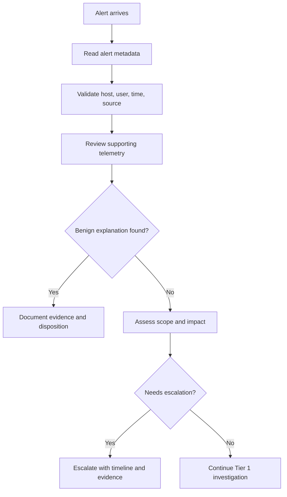
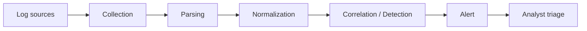
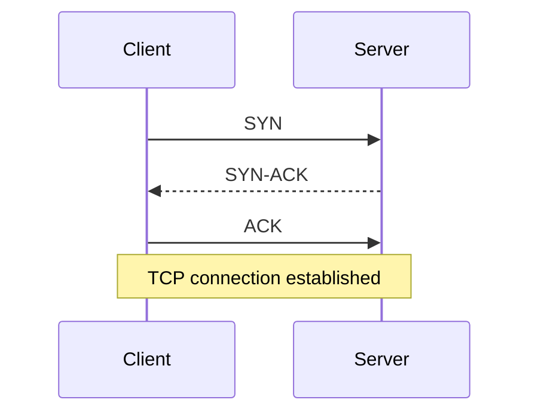
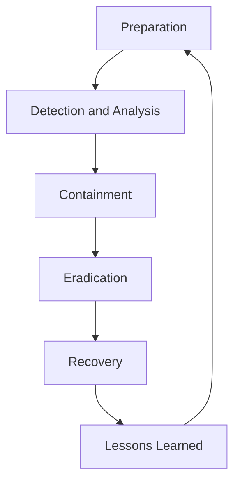
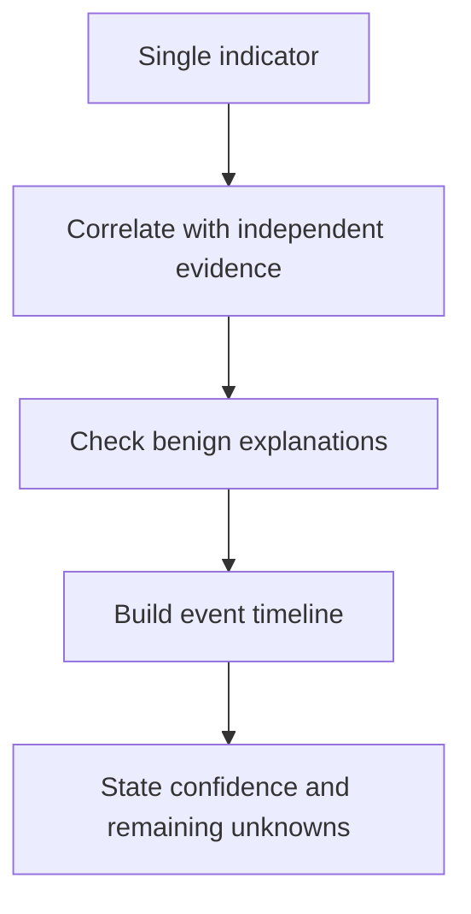

# SOC Diagram Patterns

Reusable diagram patterns. Adapt labels to the actual lesson and explain every component in Bangla.

## A. SOC alert triage

## B. SIEM data pipeline

## C. TCP three-way handshake

## D. Incident response lifecycle

Note: Framework terminology and phase groupings can vary. Name the framework/source when teaching a specific formal lifecycle.

## E. Evidence confidence ladder

Do not treat this as a universal mathematical scoring model. It is a teaching aid for disciplined reasoning.
