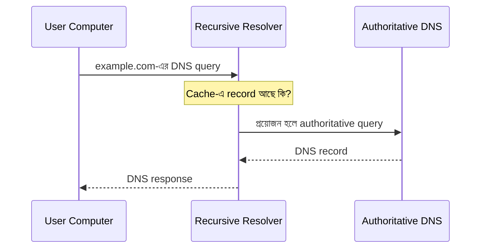

# Example: DNS কীভাবে কাজ করে?

> এটি একটি সংক্ষিপ্ত উদাহরণ। পূর্ণ ক্লাসে prerequisite, SOC scenario, verified video recommendation, lab এবং quiz যোগ করতে হবে।

## 1. শেখার লক্ষ্য

আজ বুঝব DNS কীভাবে domain name-কে IP address-এ resolve করতে সাহায্য করে এবং SOC Analyst DNS logs বা network traffic-এ কী দেখতে পারেন।

## 2. সহজ ধারণা

DNS (Domain Name System) হলো এমন একটি naming system, যা `example.com`-এর মতো domain name-এর জন্য উপযুক্ত DNS record খুঁজে দেয়। অনেক ক্ষেত্রে এটি IP address ফেরত দেয়। DNS শুধু একটি সার্ভার নয়; resolver, cache এবং বিভিন্ন DNS server মিলে resolution process সম্পন্ন করতে পারে।

## 3. Visual explanation

### ধাপে ধাপে

1. Computer DNS resolver-কে query পাঠায়।
2. Resolver cache পরীক্ষা করে।
3. Cache-এ উত্তর না থাকলে প্রয়োজন অনুযায়ী DNS hierarchy অনুসরণ করে।
4. Authoritative DNS server সংশ্লিষ্ট record দিতে পারে।
5. Resolver উত্তর Computer-এ ফেরত পাঠায়।

## 4. SOC Analyst কী দেখবেন?

- কোন host query পাঠিয়েছে?
- কোন domain query করা হয়েছে?
- Query type কী, যেমন `A`, `AAAA`, `TXT`?
- Response code কী?
- Domain-এর frequency বা pattern অস্বাভাবিক কি?
- Host-এর অন্য network activity-এর সঙ্গে query-টি মেলে কি?

একটি অস্বাভাবিক domain query একাই malware infection প্রমাণ করে না। Context এবং supporting evidence দরকার।

## 5. Simulated SOC scenario

একটি workstation অল্প সময়ে অনেকগুলো অচেনা domain query করছে।

Analyst-এর কাজ:
- Host এবং user identify করা।
- DNS query timestamps সাজানো।
- Domain reputation ও business context যাচাই করা।
- একই সময়ে process, proxy, firewall বা endpoint telemetry আছে কি না দেখা।
- Evidence ছাড়া malware infection ঘোষণা না করা।
