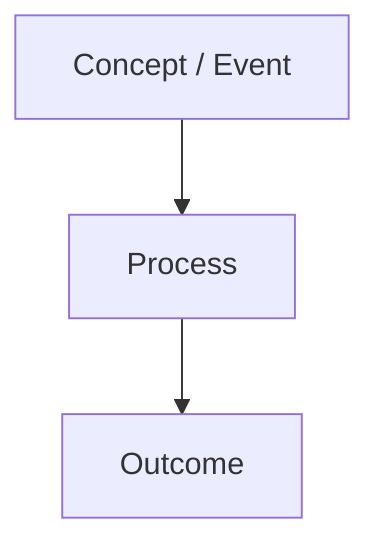

# Lesson: [TOPIC]

## 1. আজকের শেখার লক্ষ্য
- 
- 

## 2. সহজ ধারণা
[বাংলায় ব্যাখ্যা; technical terms English-এ রাখুন]

## 3. Visual explanation



### Diagram ব্যাখ্যা
1. 
2. 
3. 

## 4. Technical walkthrough

```text
[Illustrative command, log, query, or configuration]
```

| Field / Component | অর্থ | SOC Analyst কেন দেখবে |
|---|---|---|
| | | |

## 5. Realistic SOC scenario

**Scenario type:** SIMULATED

- ঘটনা:
- উপলব্ধ evidence:
- অজানা বিষয়:
- Investigation steps:
- False-positive checks:
- Escalation criteria:

## 6. YouTube / learning resource

- Primary video:
- Channel:
- Verified URL:
- Language / duration (only if verified):
- কেন এই ভিডিওটি সহায়ক:

If browsing is unavailable, use a clearly labeled YouTube search URL instead of inventing a video.

## 7. Hands-on lab

- Lab type:
- Objective:
- Requirements:
- Safety / authorization:
- Steps:
- Expected observations:
- Interpretation:
- Cleanup:

## 8. Knowledge check

### MCQ
1. 

### Short answer
1. 

### SOC scenario question
[Question]

### Practical challenge
[Challenge]

Do not reveal answers until the learner attempts them.

## 9. Quick recap
- 
- 
- 

**পরবর্তী পাঠ:** [NEXT TOPIC]
