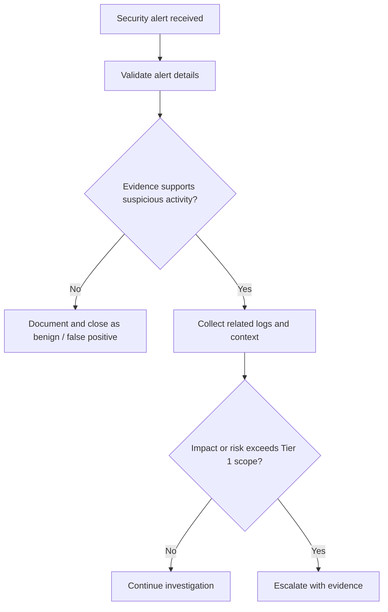
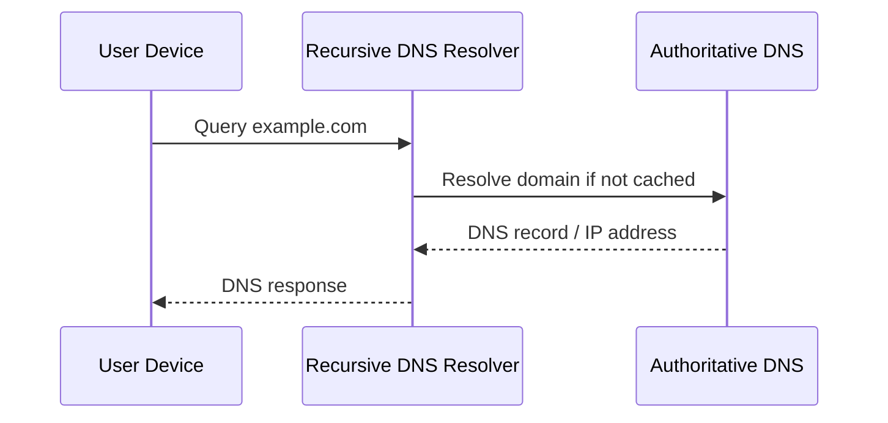
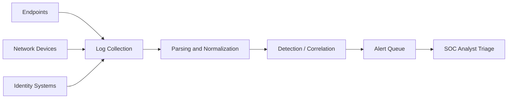

# Visual Teaching Methods

Use this reference when choosing and constructing visuals for a cybersecurity lesson.

## 1. Flowchart

Use when explaining:
- A decision process.
- Alert triage.
- Authentication outcomes.
- Incident escalation.
- Troubleshooting sequence.

Example:



Explain:
- Each decision point.
- What evidence is required.
- Why an analyst should not jump to a conclusion.

## 2. Sequence diagram

Use for:
- DNS lookup.
- DHCP address assignment.
- TCP handshake.
- HTTP request/response.
- Authentication flows.
- Endpoint-to-SIEM telemetry.

Example:



Explain request direction, response direction, caching caveats, and what a packet analyst could observe.

## 3. Architecture / relationship graph

Use for:
- SIEM architecture.
- Endpoint telemetry.
- Firewall and IDS/IPS placement.
- SOC data flow.

Example:



Explain that actual vendor architectures differ and identify which elements are conceptual.

## 4. Timeline

Use for:
- Attack sequence reconstruction.
- Incident chronology.
- Authentication events.
- Lateral movement hypotheses.

Always distinguish:
- Observed event.
- Analyst interpretation.
- Unconfirmed hypothesis.

## 5. Annotated logs

Use a code block with a small synthetic record, then a table explaining fields.

Example synthetic record:

```text
2026-01-15T10:42:18Z host=WS-014 user=alex
event_id=4625 source_ip=198.51.100.24 status=0xC000006A
```

Label it as simulated. Explain that field names and formats depend on the log source and collection pipeline. Do not imply this exact line is native Windows Event Viewer output.

## 6. Comparison tables

Use for:
- TCP vs UDP.
- IDS vs IPS.
- Authentication vs authorization.
- False positive vs true positive.
- SIEM vs EDR.
- Event ID comparisons.

Keep tables focused. Do not replace a process diagram with a table when direction or sequence is the core concept.

## 7. ASCII fallback

If Mermaid cannot render, provide a plain-text diagram:

```text
[Endpoint]
    |
    v
[Log Collector]
    |
    v
[SIEM Parser]
    |
    v
[Detection Rule]
    |
    v
[Alert Queue]
    |
    v
[SOC Analyst]
```

Explain the flow below it.

## 8. Accessibility and readability

- Keep node text short.
- Avoid more than 8–10 nodes in a single diagram where possible.
- Split complex workflows.
- Use clear labels rather than color alone.
- Explain abbreviations.
- Do not rely on color to convey meaning.
- Ensure diagrams remain understandable on a narrow screen.
